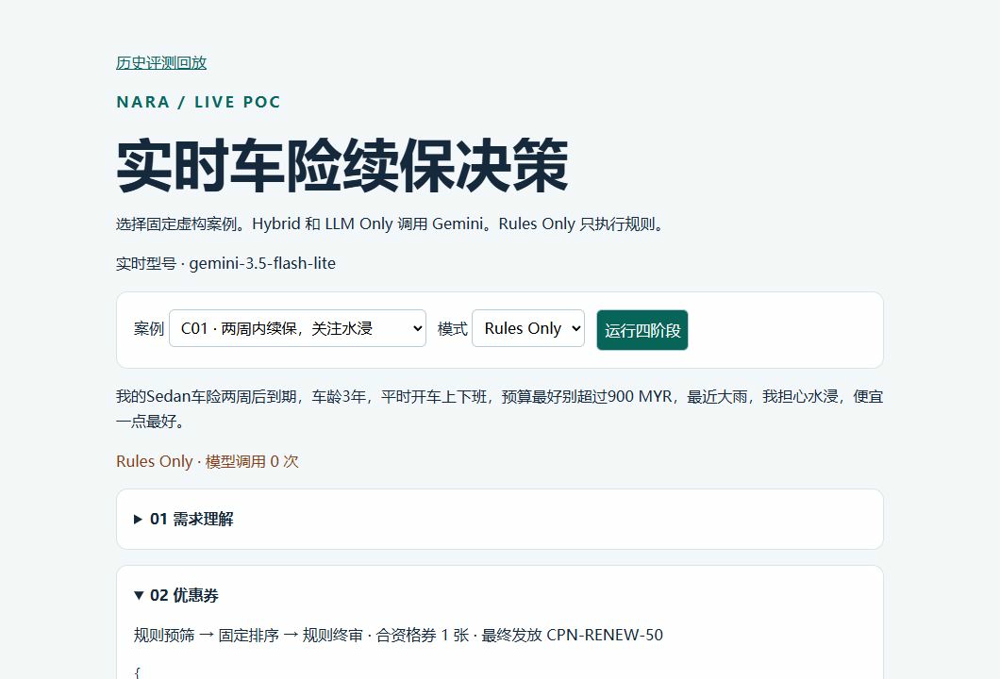
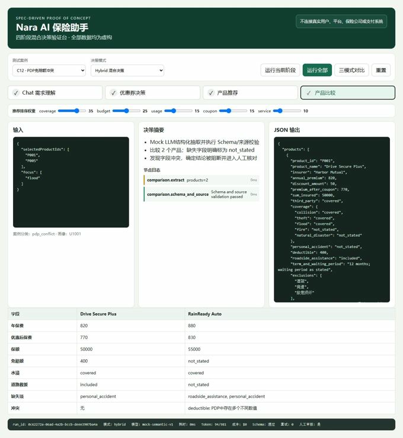

# Nara · AI 车险续保助手

**把一句续保咨询，变成可以逐步检查的保险决策。**

马来西亚车险续保｜真实 Gemini 对照评测｜AI Challenge 团队第一名


[实时 Gemini](https://nara-gemini-live.xiaoxh.chatgpt.site/live/) · [历史评测回放](https://nara-ai-insurance-poc.xiaoxh.chatgpt.site/replay/) · [参赛成片](https://nara-ai-insurance-poc.xiaoxh.chatgpt.site/film/)

## 1 · AI Challenge 背景

> “雨季快到了，我怕车泡水，预算也别太高。”

续保时，用户关心的是风险与价格。平台需要把这些表达转换为可以执行的条件，比如水浸保障、预算、车型和车龄，再核对可用优惠与产品适用范围。优惠券资格和保障条款都有明确约束，模型适合提取语言里的意图和字段，规则负责校验可执行的决定。


团队用 **Agent / Admin** 双端展示从需求理解、推荐和投保引导，到流失识别及跟进的产品设想。我负责将续保问题拆成可验证的决策步骤，搭建虚构测试数据与规则，设计对照评测，并负责产品故事重构、分镜动效、录制、剪辑和配音。PoC 使用虚构业务数据，真实调用 Gemini。参赛视频里的交易和转化状态属于演示。

## 2 · PoC 验证


| 阶段 | Hybrid 怎么做 |
| --- | --- |
| 需求理解 | Gemini 抽取用户意图、预算、车型、车龄和缺失项，由 Schema 校验输出 |
| 优惠券 | 规则校验资格和频控，Gemini 在合资格候选中排序，规则复核券和金额 |
| 产品推荐 | 过滤不适用产品，以保障匹配 60% 和优惠后价格相对预算 40% 排序 |
| 详情对比 | Gemini 从产品详情页抽取信息，规则核对来源证据与冲突，必要时标记人工核对 |

| 正常续保 · C01 | 异常处理 · PDP 字段冲突 |
| --- | --- |
|  |  |
| C01 规则模式的界面样例。关注券资格如何进入推荐，结果可逐阶段展开 | 同一详情页出现两个免赔额，界面显示冲突及人工核对 |

### 同一批案例，三种决策方式

**Hybrid** 在语义任务中用模型，并在关键环节加入规则。**Rules Only** 使用确定性规则。**LLM Only** 作为对照，移除关键业务规则与证据门禁。


| 同批评测指标 | Hybrid | Rules Only | LLM Only |
| --- | ---: | ---: | ---: |
| 全链通过 | 21/25 | 15/25 | 0/25 |
| 推荐硬条件违规项次 | 0 | 0 | 201 |
| PDP 无来源字段计数 | 0 | 0 | 0 |
| 平均全链耗时 | 18.46 秒 | 1.56 毫秒 | 21.21 秒 |

五个典型案例各重复五轮，每种模式 25 次，共 75 次执行。全链通过指同一轮四个阶段均符合预设标准。推荐违规按产品与违反条件的组合逐次累计。结果用于判断这套实现的行为，适用范围为本批虚构案例。历史导出记录的 Mock 回退运行数为 0。 [历史 Gemini 导出](public/replay/evaluation.json) · [早期 Mock 全量导出](assets/mock-evaluation.json)

> **C07｜识别了缺失信息，发券门禁仍然放行。** Hybrid 的发券阶段在五轮中通过两轮。历史样例识别出车型、车龄和预算缺失，实际字段名是 `vehicle_type`、`vehicle_age_years`、`budget`。预期是拒券并返回 `HIGH_RISK_COUPON_BLOCKED`，样例却发放 `CPN-RENEW-50`。代码核对发现门禁匹配规范字段路径，别名会漏过拦截。下一轮应统一字段路径，并用跨阶段测试验证缺失信息一定会触发预期门禁。

## 3 · 参赛视频制作

起点是一批静态页面和可跳转热区。它们能表达页面结构，但入口如何吸引注意、助手怎样开始说话、用户何时授权，都需要用时间和视觉焦点来讲。重绘整套 UI 的成本过高，当时的 Figma 账户条件也限制了把现有 HTML 转为可编辑组件。


[查看 Agent 各阶段交接参考总览](assets/agent-sections.svg)

### 镜头示例 · 从首页入口到助手开场

| 原始静态状态 | Figma 关键帧 | 成片 |
| --- | --- | --- |
|  |  | <br> |
| 确定助手入口位置与手机界面 | 标明聚焦背景约半秒淡出、聊天面板出现、第一句流式输出 | 让画面的注意力跟随入口、开场白与授权请求 |

我将镜头拆成状态、触发条件与动效时序，用 Figma 关键帧和说明让 Codex 先复述，再在网页中实现。我按画面位置和节奏逐段核对，最后录制、剪辑并配音。成片把用户侧续保咨询与 Admin 侧的线索分层及跟进连成一个故事。

[打开完整参赛视频](https://nara-ai-insurance-poc.xiaoxh.chatgpt.site/film/) · [查看 Figma 关键帧](https://www.figma.com/design/qDrQZjREMHG7DOBcmahceX/nara_shopee?node-id=26-5)

## 4 · 总结与复盘

| 我的决策 | 看到的证据 | 下一轮 |
| --- | --- | --- |
| 让模型处理语义，把资格和来源校验留给规则 | 典型集中 Hybrid 全链通过 21/25，推荐硬条件违规 0 项次 | 扩充边界案例，分开追踪理解错误、规则漏判和上游故障 |
| 将每个节点的输出和理由纳入评测 | C07 能定位到缺失字段如何跨阶段影响发券 | 将字段路径校验和拒券条件纳入跨阶段回归 |
| 用关键帧、动效说明与可运行网页完成演示 | 同一份成片串联了 Agent 与 Admin，团队获 AI Challenge 第一名 | 将镜头验收标准沉淀成可复用的分镜模板 |

### 实时体验与本地运行

打开 [实时体验](https://nara-gemini-live.xiaoxh.chatgpt.site/live/) 选择固定案例。Hybrid 与 LLM Only 使用服务端 Gemini，Rules Only 不调用模型。实时模型有地区、并发和每日用量限制。

```bash
npm ci
npm run build
npm run showcase
```

打开 `http://127.0.0.1:3002/`。本地运行 Gemini 需在服务端环境提供 `GEMINI_API_KEY`，可通过 `GEMINI_MODEL` 指定型号。公开部署配置见 [部署说明](deploy/README.md)。原 PoC 开发工作台仍可通过 `npm run dev` 使用。

### 历史评测回放

[历史评测回放](https://nara-ai-insurance-poc.xiaoxh.chatgpt.site/replay/) 可以逐案例、逐模式查看预期、实际摘要和判分差异。回放也可将 `public/` 独立部署到静态托管，入口为 `/replay/`，无需后端或模型配置。
