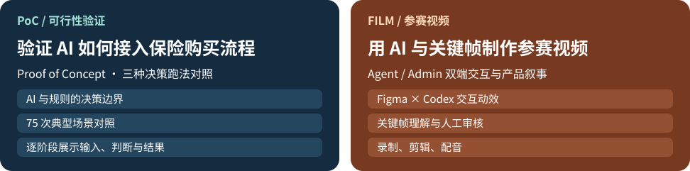
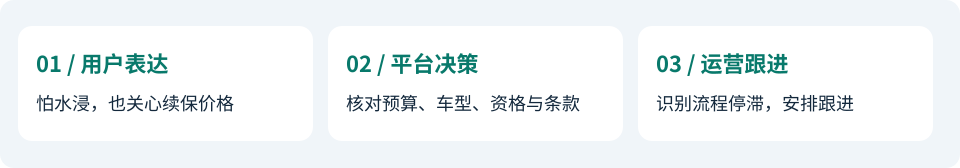
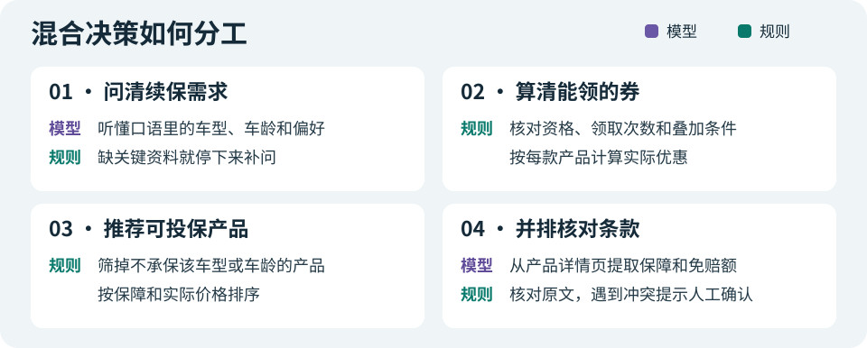
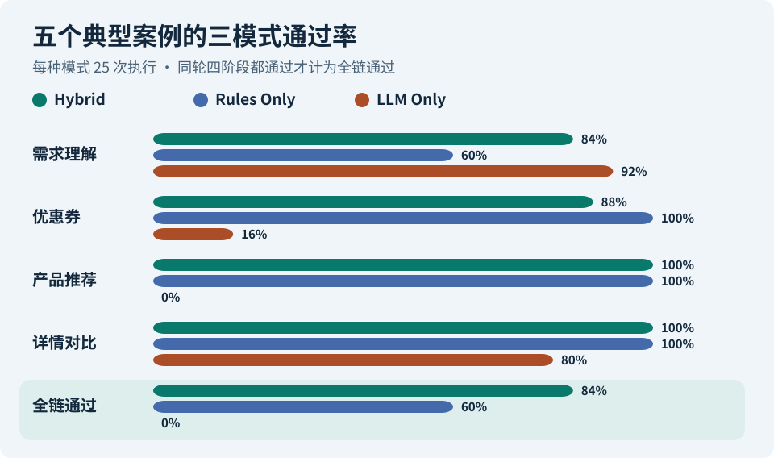
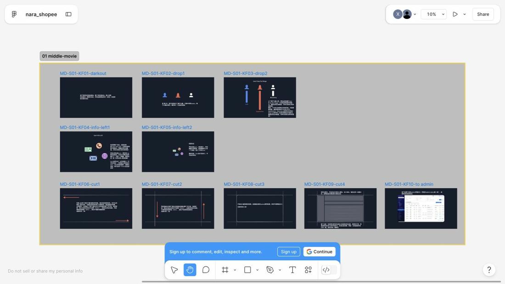
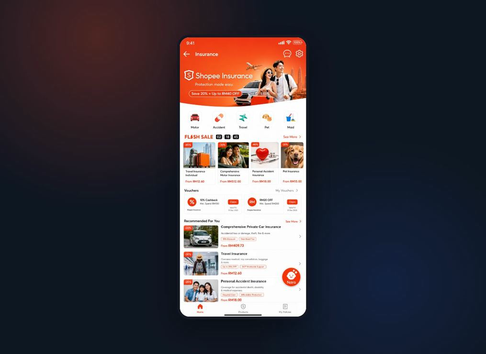

# Nara · AI 车险续保助手

马来西亚车险续保｜AI Challenge 团队第一名

<picture>
  <source media="(max-width: 680px)" srcset="assets/hero-mobile.svg">
  
</picture>

| 入口 | 打开后可以做什么 |
| --- | --- |
| [在线体验](https://nara-gemini-live.xiaoxh.chatgpt.site/live/) | 选一个虚构案例，点击「运行一次四阶段」。无需登录、安装或提供密钥 |
| [三模式评测](https://nara-gemini-live.xiaoxh.chatgpt.site/live/evaluation/) | 默认显示最近完成的新版 75 次评测。可查看逐轮差异、重跑 75 次，或在页末展开旧版基线 |
| [参赛成片](https://my.feishu.cn/file/QV6sbiMlhoekrXxT16VcyIfJnQc?from=from_copylink) · [备用播放](https://nara-ai-insurance-poc.xiaoxh.chatgpt.site/film/) | 看用户侧助手如何接续保需求，以及后台如何跟进中途退出的用户 |

在线演示中，混合决策（Hybrid）和纯模型对照（LLM Only）由 Nara 的服务器实际请求 Gemini API，使用返回结果完成相应步骤。纯规则（Rules Only）只执行规则。在线原型采用固定虚构案例，模型调用受地区与额度限制。

## 1 · 为什么做 AI 保险购买助手

组长已确定马来西亚车险续保为参赛方向。Shopee Insurance 已有车险产品详情页、报价与客服入口，适合验证一件事：能否让用户把续保问题问明白，并带着答案继续选产品和报价。

我对照了本地竞品录屏与截图。微小保录屏先由产品入口进入对话，再把解释连到推荐卡和详情页。蚁小保的「服务」录屏中，用户可以从服务列表进入产品对比，选产品后回到对话看表格。Shopee MY 现状录屏则显示，用户从产品页进入客服后仍要按客服提供的分类指引，逐步查找相关信息。

从这些可见交互看，**AI 助手的价值是把自然语言接到购买动作上**。用户可以先问自己的问题，系统再把回答整理为保障偏好、价格条件和可比较的候选，并引导到下一步。对 Nara 而言，语言模型用于理解与解读，领券、承保资格和价格仍由规则与原文证据支撑。决策时间、优惠理解和转化是待验证指标。

| 购买卡点 | Nara 的设计 | 后续怎么验证 |
| --- | --- | --- |
| **选不动** · 保障与免赔额散在不同产品详情页 | 对话提取预算和保障偏好，再并排解释产品差异和推荐理由 | 比较首次形成候选清单的耗时，以及用户能否正确说明选择依据 |
| **优惠算不清** · 活动权益、个人资格、适用范围和券后价格要一起判断 | 先说明常规权益，再展示可用券与适用条件，由规则判定资格与领取次数限制 | 观察优惠理解正确率、错误用券尝试和进入报价的比例 |
| **流程容易断** · 咨询后要重复填资料，中途退出也可能没有明确跟进线索 | 参赛演示展示授权后的轻量问询、带已有上下文进入报价，并将退出阶段和需求线索交给后台跟进 | 对比重复填写次数和报价完成率，检验后台收到的线索能否支持有效跟进 |

**设计依据：** 我们对照蚁小保和微小保的入口、对话选项、推荐和服务聚合方式，也查看了 Shopee Insurance 新马站点的产品详情页、聊天助手、券和报价因子。由此做了三个取舍：在详情页入口先围绕当前产品回答问题，用快捷选项减少输入，将正式报价所需的身份证件、邮编等字段继续留给表单。参赛演示中的叠加券、报价和后台触达属于方案展示。决策时间、优惠理解与转化仍待用户实验。

**我的工作：** 我负责将续保问题拆成可验证的决策阶段，设计虚构案例、规则和三模式评测，并重构参赛故事、制作分镜与动效、录制剪辑和配音。

## 2 · PoC 验证

用「两周后续保、三年车龄、预算 MYR 900、担心水浸」贯穿混合决策的四步：

1. **需求理解。** Gemini 提取续保时间、车型、预算与保障偏好。系统核对续保意图、车型、车龄及待确认的冲突。缺必要信息时，服务端暂停发券、推荐和对比。访客可以回答补问，或先查看再确认使用虚构示例资料。没有预算时仍可继续，推荐会标明评分依据。
2. **优惠券。** 检查输入是否足够，再按市场、领取次数、活动期、额度和适用产品筛单券。规则检查叠加关系、共同适用产品和折扣上限，按实际金额确定券组合。以资深用户（C16）为例，虚构画像有 3 次保险购买记录和 24 个月平台使用时长，满足该活动的画像条件。P008 适用 MYR 50 续保券和 MYR 15 专属券。已适用的额外优惠会计入推荐价格，点击可查看原因。
3. **产品推荐。** 先按在售、市场、车型和车龄检查投保资格，再逐款计算适用券和折扣。没有适用券的产品按原价参与评分。保障分 = 60 × 匹配关注项 ÷ 关注项。预算分 = 40 × 预算匹配比例，券后价在预算内取 1，超预算时按超出额占预算的比例递减，最低为 0。总分 = 已获分 ÷ 可计算维度的满分 × 100。只给了保障偏好且两项匹配一项时，30／60 换算为 50／100，界面标出缺少预算。两项都缺时显示缺少评分依据。同分优先券后价低的产品，再按编号排序。
4. **产品对比。** 读取各自详情页、统一字段、核对原文。已核对的价格沿用推荐阶段的逐产品计价，逐款展示原价、用券和当前价。详情页价格有冲突时，显示待核对。

### 同一个工作台，两种决策场景

**正常续保 · 两周内到期且关注水浸（C01）。** ① 条件输入 ② 资格检查与分项得分 ③ 结构化结果 ④ 用户侧的推荐与价格。

在本页展开完整工作台长图

**异常处理 · 用户已达到领券次数上限（C11）。** ① 条件输入 ② 券资格与拒券原因 ③ 发放结果 ④ 用户能看到的解释。

在本页展开完整工作台长图

### 同一批案例，三种决策方式

以下图表为旧版策略的历史结果。五个典型案例在每种模式下各跑五轮，**每种模式 25 次，共 75 次执行**。全链通过要求同一轮四阶段都符合预设标准。

| 同批指标 | Hybrid 混合决策 | Rules Only 纯规则 | LLM Only 纯模型 |
| --- | ---: | ---: | ---: |
| 全链通过 | **21/25** | **15/25** | **0/25** |
| 推荐硬条件违规项次 | 0 | 0 | 201 |
| 详情页无来源字段计数 | 0 | 0 | 0 |
| 平均全链耗时 | 18.46 秒 | 1.56 毫秒 | 21.21 秒 |

违规项次按每轮的「产品 × 违反条件」累计。历史 Gemini 批次没有记录模型步骤被模拟结果替代。公开页只提供 75 次重跑。300 次是早期模拟评测，数据单独保存。纯模型是本项目移除关键规则后的对照，结论适用范围为本批虚构典型案例。 [三模式评测](https://nara-gemini-live.xiaoxh.chatgpt.site/live/evaluation/) · [原始评测数据](public/replay/evaluation.json) · [早期 Mock 评测](assets/mock-evaluation.json)

| 场景 | 期望行为 | 历史观察 |
| --- | --- | --- |
| 两周内续保，关注水浸（C01） | 理解口语中的续保意图与水浸需求 | Hybrid 全链 5/5，纯规则需求理解 0/5 |
| 没说车型、车龄和预算（C07） | 标出缺失字段，并拦住不满足条件的发券 | Hybrid 发券 2/5。保存的样例识别了信息不足，仍发放续保券 |
| 7 年 SUV 月底续保，已达到领券次数上限（C11） | 读出车龄，并拒绝不合资格的券 | Hybrid 全链 5/5。纯规则漏读车龄，纯模型发券 0/5 |
| 同一产品详情页给出冲突的免赔额（C12） | 标记冲突并提示人工核对，保留未提供的车龄 | Hybrid 对比 5/5；需求理解有一轮没有按预期把车龄标为缺失。纯模型详情对比 0/5 |
| 11 年车龄 SUV 仍有少量可选产品（C16） | 过滤不适用产品，同时保留适用产品 | Hybrid 和纯规则全链均 5/5，纯模型推荐 0/5 |

这里的 **0/5** 指该模式在该案例、该阶段五轮均未通过。跨案例看，有三个可定位的问题：

- **口语理解和字段约定。** C01、C11 的纯规则结果漏识别口语意图或车龄。C07、C12 的 Hybrid 也出现缺失字段问题。代码核对发现，C07 保存样例中的字段别名与发券拦截条件期待的路径不一致，解释了该样例为何可能漏拦截。
- **优惠与推荐硬约束。** C11 的纯模型在频控不合格时仍发券，C16 推荐不适用产品。纯模型推荐阶段在这五个案例都未通过。后续应分别回归「该拦住」与「该保留」两种边界。
- **详情证据和人工核对。** C12 的 Hybrid 对比阶段通过五轮，纯模型样例漏掉了人工核对。后续同时检查冲突是否被标记、证据是否来自对应详情页、结论是否正确交给人工。

**新版判分。** 缺少车型和车龄（C07），或缺少车龄（C12），应补问并暂停。正确暂停计入整体场景通过，按预期未执行的阶段从各阶段分母剔除。补齐车龄后验证详情页冲突，以及访客确认使用示例资料后的续跑，作为独立回归用例。新旧两批的整体指标采用各自的策略与判分口径。

**新版实测。** 同一典型集已完成 75 次执行。Hybrid 和 LLM Only 的模型步骤实际调用 Gemini，Rules Only 使用规则。新版判分纳入两项实际流程：正常续保和领券次数上限案例的推荐中包含 P005，因此应提示免赔额冲突；高车龄案例只剩一款可保产品时，未进行横向对比符合预期。复核直接使用这 75 次的已保存输出。

| 模式 | 场景通过 | 正确暂停次数 | 仅一款可保，未对比 | 四阶段判分次数（按执行顺序） |
| --- | ---: | ---: | ---: | --- |
| Hybrid 混合决策 | 25/25 | 10 | 5 | 25 / 15 / 15 / 10 |
| Rules Only 纯规则 | 15/25 | 10 | 5 | 25 / 15 / 15 / 10 |
| LLM Only 纯模型 | 10/25 | 10 | 0 | 25 / 15 / 15 / 15 |

[下载新版逐轮报告](https://nara-gemini-live.xiaoxh.chatgpt.site/live/api/evaluations/4d51d106-9d90-43ee-8c77-682d84a05da6/result)

## 3 · 参赛视频制作

初稿已有静态页面和透明热区。早期也尝试把 HTML 状态导进 Figma，但有些页面原本就是整图和热区，导入后仍是图片层。逐页维护图层与代码映射会挤占制作时间。我保留原网页，把 Figma 用在值得强调的镜头上，为每个关键状态写清触发、时序和画面落点。Codex 复述并实现，我逐段校验，再录制、剪辑和配音。

[打开 Figma 项目](https://www.figma.com/design/qDrQZjREMHG7DOBcmahceX/nara_shopee?node-id=0-1)

### 镜头一 · 开场动画衔接 Nara 首页

左侧保留 Nara 首页的静态参考。右侧四帧按正式成片顺序，从 Nara 标识出现、周围功能图标展开，到首页落位、打开助手。原始开场分镜说明将 Nara 元素的最终位置对齐到首页右下角入口。下面的时间点均取自正式成片。

| 首页静态参考 | 正式成片中的开场关键帧 |
| --- | --- |
|  |     |

[打开助手开场关键帧](https://www.figma.com/design/qDrQZjREMHG7DOBcmahceX/nara_shopee?node-id=26-5)

### 镜头二 · 从问优惠到比较产品

| 交互状态 | 原 Figma 帧 | 成片画面 |
| --- | --- | --- |
| **问优惠。** 用户在收到推荐后想确认还有哪些权益 |  |  01:50 · 解释现有权益 |
| **展示可用券。** 在常规权益之后展示专属券和下一步操作 |  |  01:58 · 券卡片 |
| **进入报价。** 用券后回到产品详情页和报价表单，沿用前面收集的车辆上下文 |  |  02:30 · 报价表单 |
| **比较产品。** 用户在选择页提出新问题，Nara 将候选产品转换成便于阅读的差异 |  |  02:58 · 对比表展开 |

查看成片中展开的产品对比明细

该组镜头中的权益和金额属于参赛演示脚本。用户退出后的跟进由 Admin 章节接续。 [参赛成片](https://my.feishu.cn/file/QV6sbiMlhoekrXxT16VcyIfJnQc?from=from_copylink) · [备用播放](https://nara-ai-insurance-poc.xiaoxh.chatgpt.site/film/)

## 4 · 总结与复盘

| 我做的判断 | 哪些证据改变了判断 | 下一轮怎么验收 |
| --- | --- | --- |
| **模型处理口语与文本，规则守住购买条件。** | 短续保表达和口语车龄暴露了纯规则的理解缺口，频控和高车龄案例暴露了纯模型的硬约束缺口。缺失字段案例也说明混合方案需要验证阶段之间的字段约定 | 用同一语义的不同措辞、缺失字段别名及券范围边界做跨阶段回归 |
| **全链通过率用于比较，分阶段结果用于定位。** | 发券漏拦截、详情冲突漏报和高车龄过滤发生在不同环节。分阶段结果让每种失误都有对应的验收项 | 扩充边界案例并检查重复运行稳定性，再用独立用户实验验证决策时间与优惠理解 |
| **分镜约定关键状态，网页承载交互，成片校验因果。** | 开场镜头解决「用户从哪里进来」，主交互镜头解决「收到什么建议后采取什么动作」。两组镜头采用了不同的停留时间和视觉焦点 | 在成片验收中分别检查入口识别、优惠理解和报价转场，让观众能复述操作与结果的关系 |

团队获 AI Challenge 第一名。我负责把原有双端素材组织成参赛叙事，并完成分镜、动效验收和视频交付。 [开发与部署说明](deploy/README.md)
