# Nara · AI 车险续保助手

马来西亚车险续保｜AI Challenge 团队第一名

<picture>
  <source media="(max-width: 680px)" srcset="assets/hero-mobile.svg">
  
</picture>

| 入口 | 打开后可以做什么 |
| --- | --- |
| [在线体验](https://nara-gemini-live.xiaoxh.chatgpt.site/live/) | 选一个虚构案例，点击「运行一次四阶段」。无需登录、安装或提供密钥 |
| [三模式评测](https://nara-gemini-live.xiaoxh.chatgpt.site/live/evaluation/) | 先看新版 75 次结果。可以展开逐案记录，或重新运行 75 次 |
| [参赛成片](https://my.feishu.cn/file/QV6sbiMlhoekrXxT16VcyIfJnQc?from=from_copylink) · [备用播放](https://nara-ai-insurance-poc.xiaoxh.chatgpt.site/film/) | 看用户如何咨询续保，以及后台如何跟进中途退出的用户 |

Gemini 是 Google 的大语言模型。在线体验中，混合决策和纯模型都会实际调用 Gemini，纯规则按预设条件执行。案例为虚构示例，模型调用受地区和额度限制。

## 1 · 为什么做 AI 保险购买助手

团队选了马来西亚车险续保参赛。Shopee Insurance 已有产品页、客服和报价流程，我想验证的是，用户能否先把「我怕水浸、预算有限」说清楚，再带着答案去选保险。

我对照了微小保和蚁小保的录屏。前者把对话解释接到推荐卡和详情页，后者让用户在对话里看对比表。Shopee MY 的客服入口则需要用户按分类继续查找。Nara 因此从产品页接住问题，用快捷选项减少输入，把证件和邮编留到正式报价表单。

| 用户卡在哪里 | Nara 怎么处理 | 接下来测什么 |
| --- | --- | --- |
| **保障难比较** | 问清预算和保障偏好，把产品差异并排展示 | 找到合适选项的时间、能否说清选择理由 |
| **优惠难算清** | 说明能领什么券、适用哪些产品、最后多少钱 | 优惠理解、错用券次数、进入报价的比例 |
| **咨询后容易中断** | 报价时沿用已提供的信息，退出后给运营留下跟进线索 | 重复填写次数、报价完成率、线索能否支持跟进 |

PoC 用虚构案例验证决策是否正确。报价和运营跟进在参赛视频中展示，省时和转化留待用户实验。

**我的工作。** 我设计了决策流程、虚构案例和三模式评测，并负责参赛视频的叙事、分镜、动效验收、录制、剪辑和配音。

## 2 · PoC 验证

- **先问清楚。** 模型从口语里提取续保需求。缺车型或车龄时，系统停下来补问。预算没填仍可继续，推荐会说明依据。访客可以自己回答，也可以确认使用示例资料。
- **再算优惠和推荐。** 规则检查领券资格、叠加条件和投保限制，再按保障与实际价格排序。例如资深用户（C16）有 3 次购买记录、使用平台 24 个月，产品 P008 可用 MYR 50 续保券和 MYR 15 专属券。
- **最后核对详情。** 对比表逐款列出原价、用券和现价。详情页里的免赔额或价格有冲突时，会提示人工核对。

查看推荐分怎么算

| 分数 | 计算方法 |
| --- | --- |
| **保障分，满分 60** | 60 × 匹配的保障项数 ÷ 关注项数。关注两项、匹配一项得 30 分。 |
| **预算分，满分 40** | 40 × max(0, 1 − 超出额 ÷ max(预算, 1 MYR))。超出额 = max(0, 实际价格 − 预算)。预算 MYR 1,000 时，实际价格 MYR 900、1,250、2,000 分别得 **40、30、0 分**。 |
| **总分，满分 100** | 两项相加。只提供一个维度时，用该维度得分除以满分，再乘 100。例如保障分 30 ÷ 60 × 100 = 50。两项都缺时，标记「缺少个性化评分依据」。无分或同分时，按实际价格、产品编号排序。 |

实际价格采用券后价，无适用券时采用原价。混合决策和纯规则用这套公式，纯模型采用模型给出的排序。

### 工作台里的两种场景

**正常续保 · 两周内到期且关注水浸（C01）。** 展开可看投保资格、预算得分和最终推荐。

展开完整工作台长图

**异常处理 · 达到领券次数上限（C11）。** 展开可看领券上限的核验过程，以及用户收到的拒券说明。

展开完整工作台长图

### 同一批案例，三种决策方式

从 20 个虚构案例中选 5 个典型场景。每个场景用 3 种模式各跑 5 轮，共 **75 次**，每种模式 25 次。工作台可逐个体验全部 20 个案例。现场建议重跑 75 次，全量 300 次可能超出 Gemini 的每日配额。

**怎么算通过。** 每轮按案例预期判断。该补问时停下来，或只有一款可保时跳过横向对比，都算全链路通过。按预期跳过的环节从对应阶段的分母剔除。

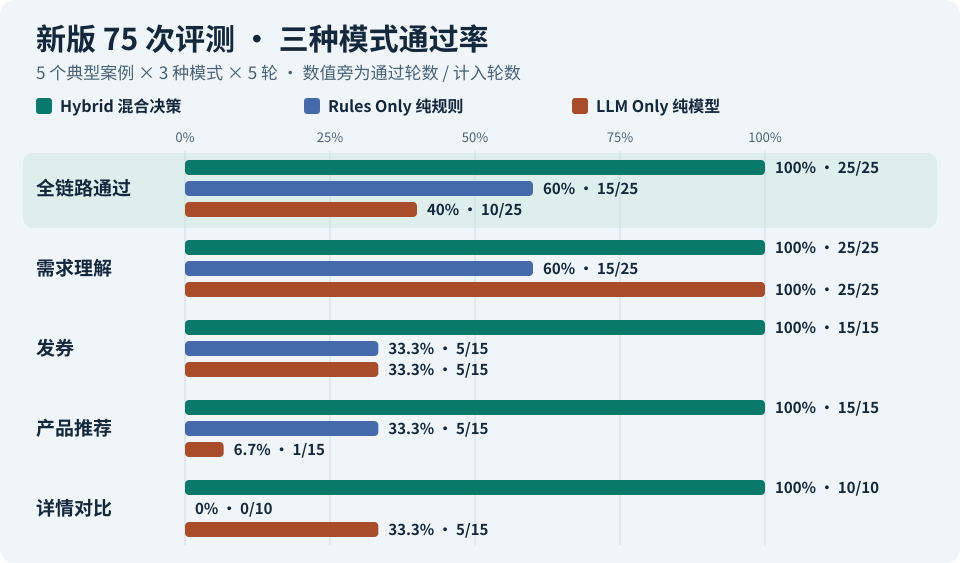

图中比例是通过轮数除以计入该项的总轮数。

| 指标 | Hybrid 混合决策 | Rules Only 纯规则 | LLM Only 纯模型 |
| --- | ---: | ---: | ---: |
| **四阶段全链路均通过** | **25/25** | **15/25** | **10/25** |
| 其中正确补问并暂停 | 10 | 10 | 10 |
| 其中仅一款可保，跳过对比 | 5 | 5 | 0 |
| 推荐硬条件违规项次 | 0 | 0 | 68 |
| 平均单轮处理耗时 | 4.38 秒 | 0 毫秒（报告计时精度） | 12.98 秒 |
| 各阶段计入通过率的轮次 | 25 / 15 / 15 / 10 | 25 / 15 / 15 / 10 | 25 / 15 / 15 / 15 |

同一款产品违反两项条件，就计两项违规。平均耗时包含正确暂停的轮次。 [三模式评测](https://nara-gemini-live.xiaoxh.chatgpt.site/live/evaluation/) · [新版逐轮报告](https://nara-gemini-live.xiaoxh.chatgpt.site/live/api/evaluations/4d51d106-9d90-43ee-8c77-682d84a05da6/result)

#### 三种跑法各自容易卡在哪一步

**混合决策的优势出现在两个地方。** 模型能听懂「车险两周后到期」和「7 年 SUV」，规则能拦住发错的券、排除不适用的保险，对比结果还会核对原文。在这五个虚构场景里，混合决策通过 25/25。

| 跑法 | 特点 | 这批案例暴露了什么 |
| --- | --- | --- |
| **混合决策** | 模型理解口语，规则把关领券和投保资格，最后核对条款。但模型读错车型或车龄时，规则也可能据此做出错误判断。 | 综合最优，无明显缺点。 |
| **纯规则** | 擅长执行明确条件，但依赖关键词和预设路径。用户换个说法，规则就可能漏掉本来能继续的情况，把路走窄。 | C16 能排除不承保高车龄车辆的产品。C01 没认出用户要续保，C11 漏读车龄，后续步骤都停了。 |
| **纯模型** | 擅长理解不同说法，也能推断用户意图，但容易把「可能合适」当成「符合资格」，把路走宽，比如超限发券或推荐不能投保的产品。 | C01 选错券、漏报免赔额冲突。C11 到了领券上限仍发券。C16 五轮都推荐了不适用的产品。 |

C07 和 C12 都缺必要资料，三种模式都正确暂停。真正拉开差距的是资料齐全后，能否继续做对发券、推荐和对比。

展开五个场景的逐项结果

每个阶段分别判定。比如「通过 1/5」表示五轮里有一轮达标。「未执行」会注明是按预期暂停，还是前一步出了问题。

##### C01 · 正常续保，关注水浸

**场景。** 用户说车险两周后到期，担心水浸，希望控制价格。

**期望。** 读出续保和水浸需求，选合适的券与产品，并提示详情页里的免赔额冲突。

| 跑法 | 需求理解 | 发券 | 推荐 | 对比 | 全链路通过 |
| --- | --- | --- | --- | --- | ---: |
| Hybrid 混合决策 | 通过 5/5 | 通过 5/5 | 通过 5/5 | 通过 5/5 | **5/5** |
| Rules Only 纯规则 | 通过 0/5 | 需求理解未通过，未执行 5 轮 | 需求理解未通过，未执行 5 轮 | 需求理解未通过，未执行 5 轮 | **0/5** |
| LLM Only 纯模型 | 通过 5/5 | 通过 0/5 | 通过 1/5 | 通过 0/5 | **0/5** |

**结果。** 纯规则没有把「车险两周后到期」识别成续保，所以后续没运行。纯模型听懂了需求，但选错了券，且五轮都没有提示免赔额冲突。

##### C07 · 缺少车型和车龄

**场景。** 用户说想续保、希望保障全面，但没提供车型和车龄。

**期望。** 先问清车型和车龄，等用户回答后再发券、推荐和对比。

| 跑法 | 需求理解 | 发券 | 推荐 | 对比 | 全链路通过 |
| --- | --- | --- | --- | --- | ---: |
| Hybrid 混合决策 | 通过 5/5 | 按预期暂停，未执行 5 轮 | 按预期暂停，未执行 5 轮 | 按预期暂停，未执行 5 轮 | **5/5** |
| Rules Only 纯规则 | 通过 5/5 | 按预期暂停，未执行 5 轮 | 按预期暂停，未执行 5 轮 | 按预期暂停，未执行 5 轮 | **5/5** |
| LLM Only 纯模型 | 通过 5/5 | 按预期暂停，未执行 5 轮 | 按预期暂停，未执行 5 轮 | 按预期暂停，未执行 5 轮 | **5/5** |

**结果。** 三种模式都在正确的位置停下。

##### C11 · 7 年 SUV 达到领券上限

**场景。** 用户要为 7 年车龄的 SUV 续保，虚构画像已经领满本轮优惠券。

**期望。** 读出车龄，拒发优惠券，继续按原价推荐，并提示详情页里的免赔额冲突。

| 跑法 | 需求理解 | 发券 | 推荐 | 对比 | 全链路通过 |
| --- | --- | --- | --- | --- | ---: |
| Hybrid 混合决策 | 通过 5/5 | 通过 5/5 | 通过 5/5 | 通过 5/5 | **5/5** |
| Rules Only 纯规则 | 通过 0/5 | 需求理解未通过，未执行 5 轮 | 需求理解未通过，未执行 5 轮 | 需求理解未通过，未执行 5 轮 | **0/5** |
| LLM Only 纯模型 | 通过 5/5 | 通过 0/5 | 通过 0/5 | 通过 0/5 | **0/5** |

**结果。** 纯规则没读出「7 年 SUV」的车龄，流程因此停下。纯模型读对了车龄，却仍发了券，推荐也违反了投保条件。

##### C12 · 想比较两款产品，但没说车龄

**场景。** 用户点名要比较 P001 和 P005，原话里没有车龄。

**期望。** 先补问车龄。车龄确认后再确定可推荐和对比的产品。

| 跑法 | 需求理解 | 发券 | 推荐 | 对比 | 全链路通过 |
| --- | --- | --- | --- | --- | ---: |
| Hybrid 混合决策 | 通过 5/5 | 按预期暂停，未执行 5 轮 | 按预期暂停，未执行 5 轮 | 按预期暂停，未执行 5 轮 | **5/5** |
| Rules Only 纯规则 | 通过 5/5 | 按预期暂停，未执行 5 轮 | 按预期暂停，未执行 5 轮 | 按预期暂停，未执行 5 轮 | **5/5** |
| LLM Only 纯模型 | 通过 5/5 | 按预期暂停，未执行 5 轮 | 按预期暂停，未执行 5 轮 | 按预期暂停，未执行 5 轮 | **5/5** |

**结果。** 这批评测验证的是补问。

##### C16 · 11 年车龄 SUV，只剩一款可保

**场景。** 用户要为 11 年车龄的 SUV 续保。

**期望。** 排除超过车龄上限的产品，仅剩一款时直接说明结果，跳过横向对比。

| 跑法 | 需求理解 | 发券 | 推荐 | 对比 | 全链路通过 |
| --- | --- | --- | --- | --- | ---: |
| Hybrid 混合决策 | 通过 5/5 | 通过 5/5 | 通过 5/5 | 仅一款可保，跳过 5 轮 | **5/5** |
| Rules Only 纯规则 | 通过 5/5 | 通过 5/5 | 通过 5/5 | 仅一款可保，跳过 5 轮 | **5/5** |
| LLM Only 纯模型 | 通过 5/5 | 通过 5/5 | 通过 0/5 | 通过 5/5 | **0/5** |

**结果。** 混合决策和纯规则都只保留了 P008。纯模型虽然通过了需求理解、发券和详情对比，但五轮都推荐了不适用的产品，所以全链路为 0/5。

查看 C01–C20 完整案例目录

| 编号 | 场景 | 纳入 75 次评测 |
| --- | --- | --- |
| C01 | 两周内续保，关注水浸 | 是 |
| C02 | SUV长途驾驶 | 否 |
| C03 | 价格优先通勤 | 否 |
| C04 | 完整高保障需求 | 否 |
| C05 | 口语化雨季需求 | 否 |
| C06 | 隐含道路救援 | 否 |
| C07 | 缺少车辆与预算 | 是 |
| C08 | 自相矛盾预算 | 否 |
| C09 | 市场不符合 | 否 |
| C10 | 分群与时效不符合 | 否 |
| C11 | 频控冲突 | 是 |
| C12 | PDP免赔额冲突 | 是 |
| C13 | VIP主券频控但叠加券仍可发 | 否 |
| C14 | 新用户已有User Voucher | 否 |
| C15 | 雨季用户已领防洪券 | 否 |
| C16 | 资深用户专属券 · 高车龄 SUV | 是 |
| C17 | 仅有行为意图但对话缺关键字段 | 否 |
| C18 | 续保口述，超时重试为本地模拟用例 | 否 |
| C19 | VIP无近期领券记录 | 否 |
| C20 | 老旧Hatchback价格优先 | 否 |

展开旧版 75 次 Gemini 评测与早期 300 次模拟记录

- **旧版 75 次 Gemini 评测。** 四个阶段都执行并通过才算全链通过。混合决策、纯规则、纯模型分别通过 21/25、15/25、0/25。 [旧版 75 次原始数据](public/replay/evaluation.json)
- **早期 300 次模拟评测。** 20 个案例 × 3 种模式 × 5 轮，模型步骤使用模拟结果。 [早期 300 次原始数据](assets/mock-evaluation.json)

## 3 · 参赛视频制作

初稿只有静态页面和点击跳转，难以讲清用户怎么从咨询走到报价。把 HTML 导进 Figma 后，部分页面仍是图片层。我保留原网页，在 Figma 标清关键画面、触发动作和时长，让 Codex 实现交互，再逐段核对、录制、剪辑和配音。

[打开 Figma 项目](https://www.figma.com/design/qDrQZjREMHG7DOBcmahceX/nara_shopee?node-id=0-1)

### 镜头一 · 开场动画衔接 Nara 首页

<table>
  <thead>
    <tr><th>阶段说明</th><th>原 Figma 帧</th><th>成片画面</th></tr>
  </thead>
  <tbody>
    <tr>
      <td rowspan="2" valign="top" width="210">开场动画让 Nara 标志伴随 AI Guided Purchase 字样出场，随后让标志落到 Shopee 首页右下角，自然带出打开助手的入口。</td>
      <td valign="top"><a href="https://raw.githubusercontent.com/xiaoberon/nara-ai-insurance-poc/main/assets/demo-video/2.svg">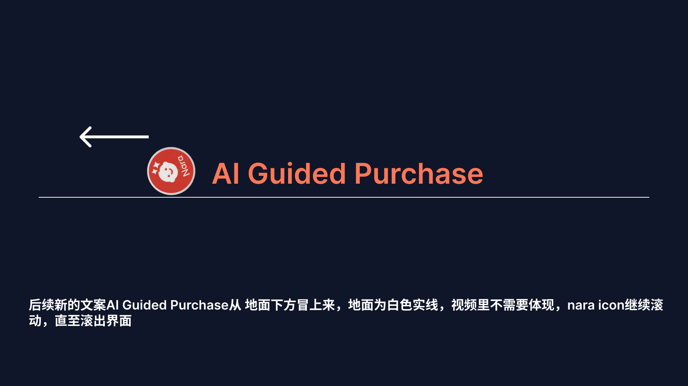</a> <strong>2</strong> · Nara 标志随 AI Guided Purchase 字样出场</td>
      <td valign="top"><a href="https://raw.githubusercontent.com/xiaoberon/nara-ai-insurance-poc/main/assets/demo-video/2-2.png">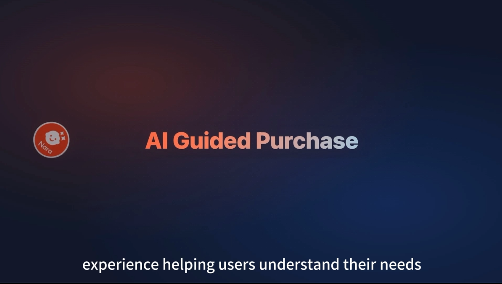</a> <strong>2-2</strong> · 标志与标题在正式成片中同步出现</td>
    </tr>
    <tr>
      <td valign="top"><a href="https://raw.githubusercontent.com/xiaoberon/nara-ai-insurance-poc/main/assets/demo-video/3.svg">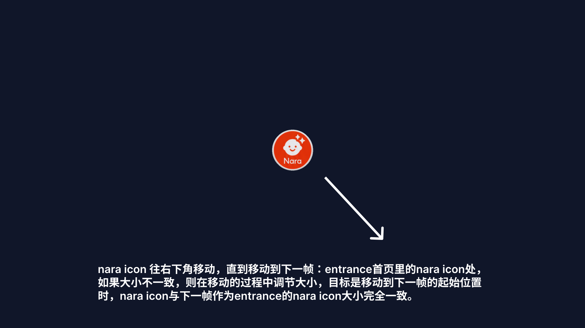</a> <strong>3</strong> · 标志向 Shopee 首页入口移动</td>
      <td valign="top"><a href="https://raw.githubusercontent.com/xiaoberon/nara-ai-insurance-poc/main/assets/demo-video/3-3.png">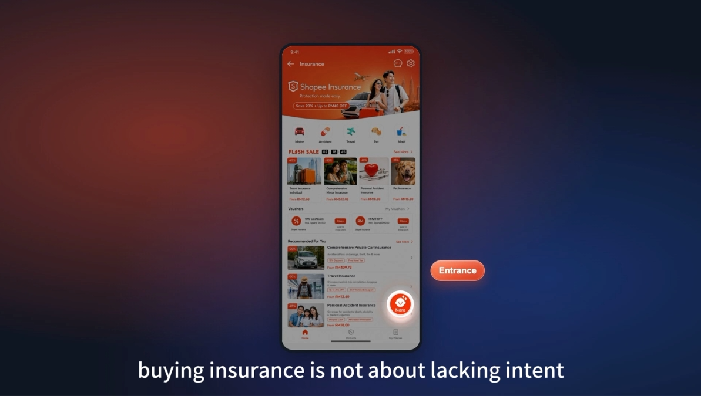</a> <strong>3-3</strong> · 标志落到首页右下角，成为开启 Nara 的入口</td>
    </tr>
  </tbody>
</table>

### 镜头二 · 从问优惠到比较产品

| 交互状态 | 原 Figma 帧 | 成片画面 |
| --- | --- | --- |
| **问优惠。** 用户在收到推荐后想确认还有哪些权益 |  |  01:50 · 解释现有权益 |
| **展示可用券。** 在常规权益之后展示专属券和下一步操作 |  |  01:58 · 券卡片 |
| **进入报价。** 用券后回到产品详情页和报价表单，沿用已经填写的车辆信息 |  |  02:30 · 报价表单 |
| **比较产品。** 用户在选择页提出新问题，Nara 把候选产品的保障和价格并排展示 |  |  02:58 · 对比表展开 |

查看成片中展开的产品对比明细

这组镜头中的权益和金额来自参赛演示脚本。

### 镜头三 · 从前台 Agent 转到后台 Admin

<table>
  <thead>
    <tr><th>阶段说明</th><th>原 Figma 帧</th><th>成片画面</th></tr>
  </thead>
  <tbody>
    <tr>
      <td rowspan="2" valign="top" width="210">用户离开前台后，后台把用户留下的续保资料和意向整理成待跟进线索。动画用信息图标和描边，把手机助手接到电脑后台。</td>
      <td valign="top"><a href="https://raw.githubusercontent.com/xiaoberon/nara-ai-insurance-poc/main/assets/demo-video/4.svg">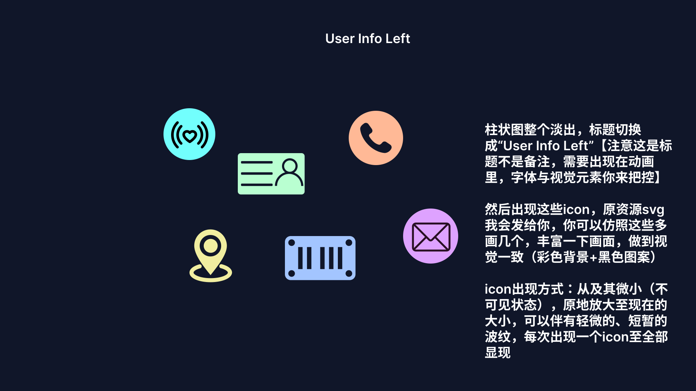</a> <strong>4</strong> · 用图标表现用户离开前留下的信息</td>
      <td valign="top"><a href="https://raw.githubusercontent.com/xiaoberon/nara-ai-insurance-poc/main/assets/demo-video/4-4.png">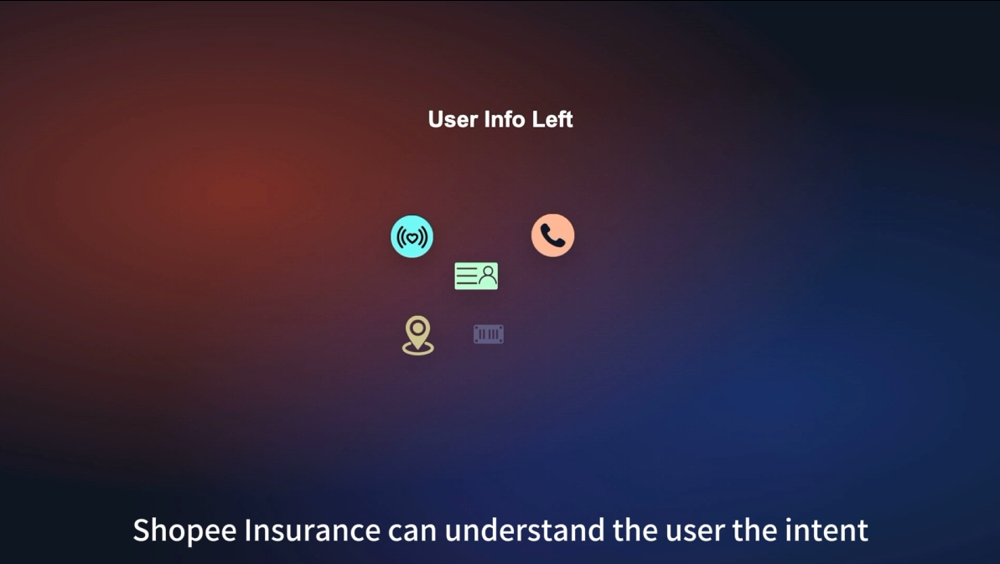</a> <strong>4-4</strong> · 用户留下的信号随图标逐个出现</td>
    </tr>
    <tr>
      <td valign="top"><a href="https://raw.githubusercontent.com/xiaoberon/nara-ai-insurance-poc/main/assets/demo-video/5.svg">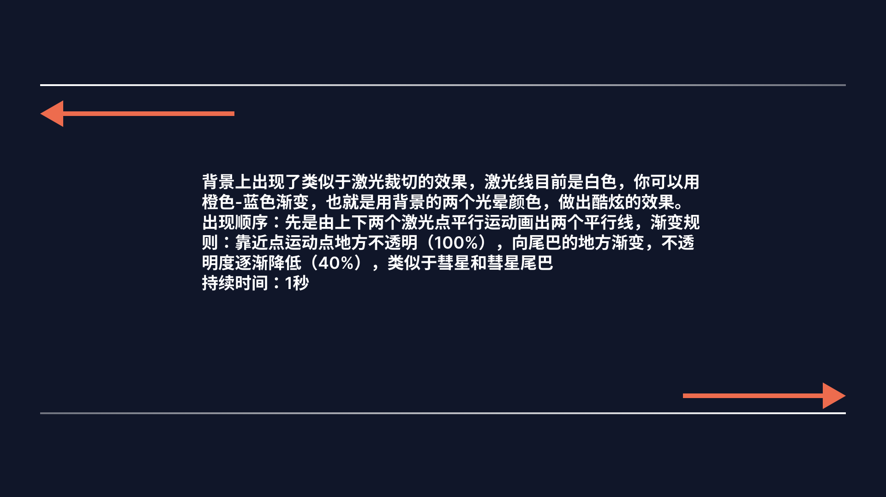</a> <strong>5</strong> · 用线条的方向和节奏规划转场</td>
      <td valign="top"> <strong>5-5</strong> · 描边勾勒出 PC 后台界面</td>
    </tr>
  </tbody>
</table>

### 镜头四 · 后台线索分层与二次触达

<table>
  <thead>
    <tr><th>交互状态</th><th>原 Figma 帧</th><th>成片画面</th></tr>
  </thead>
  <tbody>
    <tr>
      <td valign="top" width="210"><strong>按价值分层。</strong> 后台汇总用户留下的线索，结合续保到期日和意向信号，确定跟进优先级。</td>
      <td valign="top"><a href="https://raw.githubusercontent.com/xiaoberon/nara-ai-insurance-poc/main/assets/demo-video/6.svg">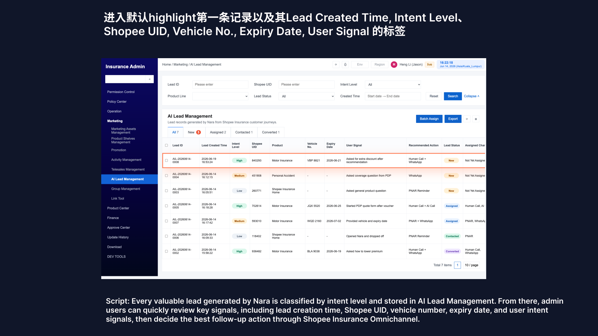</a> <strong>6</strong> · 后台列表按线索价值分层</td>
      <td valign="top"><a href="https://raw.githubusercontent.com/xiaoberon/nara-ai-insurance-poc/main/assets/demo-video/6-6.png">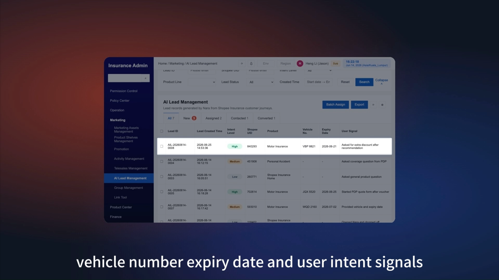</a> <strong>6-6</strong> · 高亮运营需要查看的线索字段</td>
    </tr>
    <tr>
      <td valign="top" width="210"><strong>人工通话二次触达。</strong> 高价值线索由运营人员参考助手摘要和联系记录，进行人工电话跟进。中低价值线索可通过 AI 外呼等方式跟进，此处略。</td>
      <td valign="top"><a href="https://raw.githubusercontent.com/xiaoberon/nara-ai-insurance-poc/main/assets/demo-video/7.svg">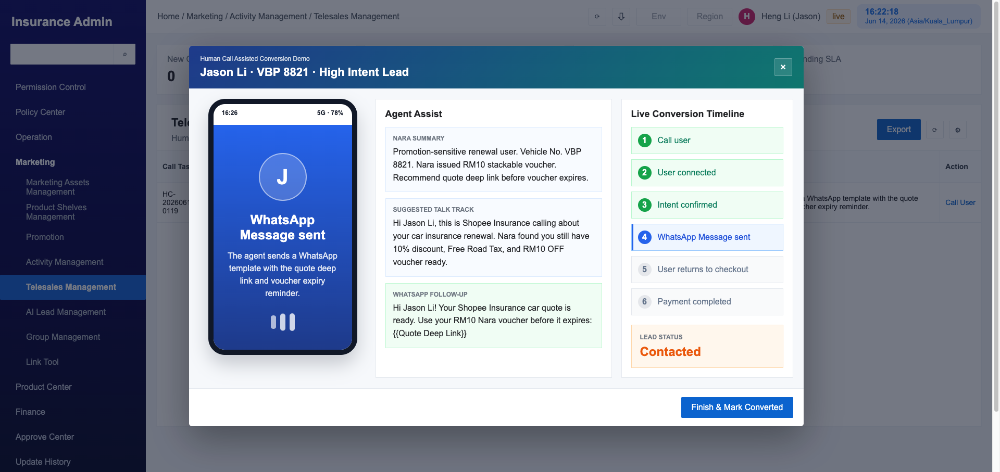</a> <strong>7</strong> · 高价值线索的人工跟进面板</td>
      <td valign="top"><a href="https://raw.githubusercontent.com/xiaoberon/nara-ai-insurance-poc/main/assets/demo-video/7-7.png">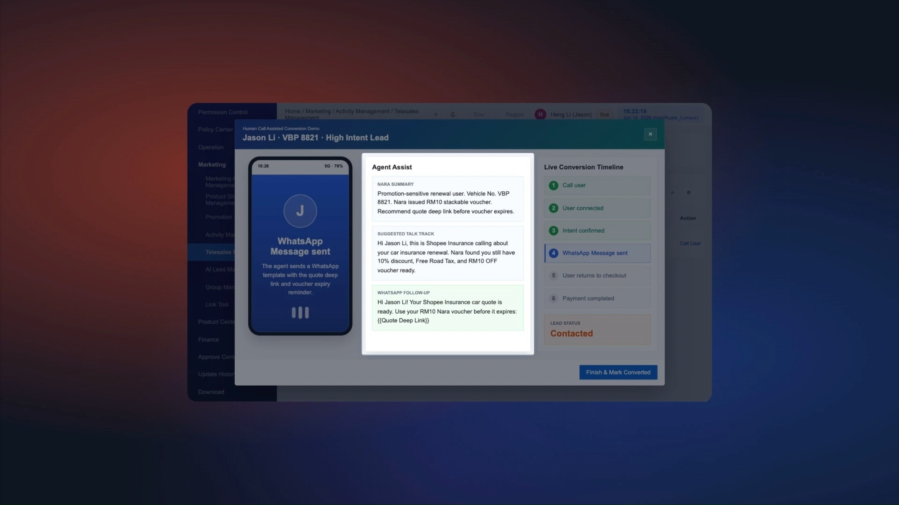</a> <strong>7-7</strong> · 跟进面板展示助手摘要和联系记录</td>
    </tr>
  </tbody>
</table>

[参赛成片](https://my.feishu.cn/file/QV6sbiMlhoekrXxT16VcyIfJnQc?from=from_copylink) · [备用播放](https://nara-ai-insurance-poc.xiaoxh.chatgpt.site/film/)

## 4 · 总结与复盘

| 这次做出的决定 | 下一步验证什么 |
| --- | --- |
| **让模型听懂问题，让规则守住资格。** 缺关键资料时暂停，能继续时按明确条件发券和推荐。 | 加入口语改写、资料冲突和优惠边界，检查流程是否稳定。 |
| **用逐步结果定位失败。** 先看是没听懂、发错券，还是选错了产品，再决定改哪里。 | 用真实用户实验测决策时间、优惠理解和报价完成率。 |
| **用分镜约定关键画面，再用网页实现连续操作。** 开场交代入口，主交互交代用户为何采取下一步。 | 请首次观看的人复述优惠怎么用、报价怎么接、后台怎么跟进。 |

[开发与部署说明](deploy/README.md)
