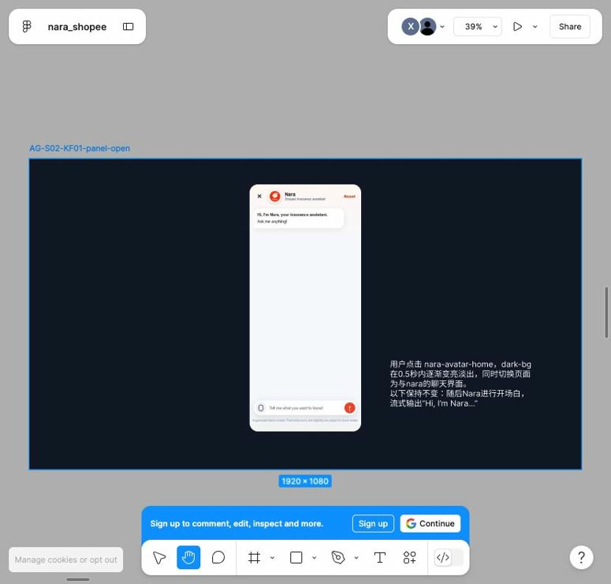
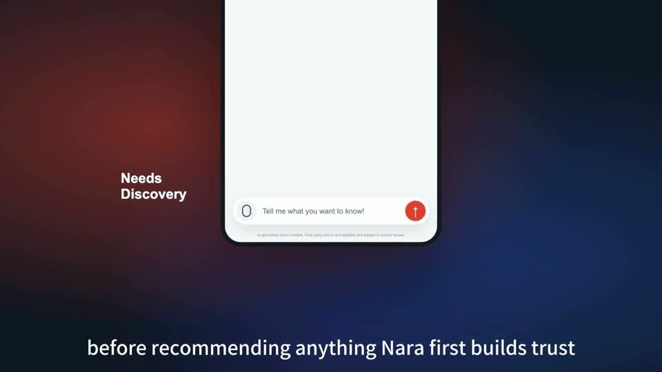

# Nara · AI 车险续保助手

**把「怕车泡水、预算别太高」变成一组能比较、能解释的续保选项。**

马来西亚车险续保｜方案验证原型（PoC）｜AI Challenge 团队第一名

| 入口 | 打开后可以做什么 |
| --- | --- |
| [在线体验](https://nara-gemini-live.xiaoxh.chatgpt.site/live/) | 选一个虚构案例，点击「运行一次四阶段」。无需登录、安装或提供密钥 |
| [历史评测](https://nara-ai-insurance-poc.xiaoxh.chatgpt.site/replay/) | 查看已保存的三模式结果、逐案例标准和差异。浏览时不会调用模型 |
| [参赛成片](https://my.feishu.cn/file/QV6sbiMlhoekrXxT16VcyIfJnQc?from=from_copylink) · [备用播放](https://nara-ai-insurance-poc.xiaoxh.chatgpt.site/film/) | 看用户侧助手如何接续保需求，以及后台如何跟进中途退出的用户 |

Gemini 是 Google 的大语言模型。在线演示中，混合决策（Hybrid）和纯模型对照（LLM Only）由 Nara 的服务器实际请求 Gemini API，使用返回结果完成相应步骤。纯规则（Rules Only）只执行规则。在线原型采用固定虚构案例，模型调用受地区与额度限制。

## 1 · 为什么做车险续保

> 「雨季快到了，我怕车泡水，预算也别太高。」

这句话已经表达了用户的优先级。要做出购买决定，用户还得查明哪些产品适合自己的车、哪些保障包含水浸、哪些券能用，以及使用后的价格。Nara 的切入点是让对话承接这些具体决策，并让用户能顺着答案继续报价。

| 购买卡点 | Nara 的设计 | 后续怎么验证 |
| --- | --- | --- |
| **选不动** · 保障与免赔额散在不同产品详情页 | 对话提取预算和保障偏好，再并排解释产品差异和推荐理由 | 比较首次形成候选清单的耗时，以及用户能否正确说明选择依据 |
| **优惠算不清** · 活动权益、个人资格、适用范围和券后价格要一起判断 | 先说明常规权益，再展示可用券与适用条件，由规则判定资格与领取次数限制 | 观察优惠理解正确率、错误用券尝试和进入报价的比例 |
| **流程容易断** · 咨询后要重复填资料，中途退出也可能没有明确跟进线索 | 参赛演示展示授权后的轻量问询、带已有上下文进入报价，并将退出阶段和需求线索交给后台跟进 | 对比重复填写次数和报价完成率，检验后台收到的线索能否支持有效跟进 |

**设计依据。** 我们对照蚁小保和微小保的入口、对话选项、推荐和服务聚合方式，也查看了 Shopee Insurance 新马站点的产品详情页、聊天助手、券和报价因子。由此做了三个取舍：在详情页入口先围绕当前产品回答问题，用快捷选项减少输入，将正式报价所需的身份证件、邮编等字段继续留给表单。参赛演示中的叠加券、报价和后台触达属于方案展示。决策时间、优惠理解与转化仍待用户实验。

**我的工作。** 我负责将续保问题拆成可验证的决策阶段，设计虚构案例、规则和三模式评测，并重构参赛故事、制作分镜与动效、录制剪辑和配音。团队的原始 Agent／Admin 演示与业务构想为双端故事提供了起点。

## 2 · PoC 验证

用「两周后续保、三年车龄、预算 MYR 900、担心水浸」贯穿混合决策的四步：

1. **需求理解 · 把用户原话变成条件。** Gemini 提取车型、车龄、续保时间、预算和保障偏好。系统检查字段与格式是否符合约定，并保留缺失项。格式合法只能说明输出能交给下一阶段，字段是否准确仍需要用案例验收。
2. **优惠券 · 先判断能不能领，再判断哪张合适。** 规则依次核对市场、用户分群、续保窗口、活动状态、预算、同一用户的领取次数、适用产品和折扣上限。Gemini 在合资格候选中选择，系统再复核券编号和金额。没有合资格候选时拒券，决策记录保留每张券被排除的原因。
3. **产品推荐 · 先排除买不了的，再解释排序。** 系统按在售状态、市场、车型、车龄和优惠券适用范围过滤。对留下的产品按保障匹配 **60%**、优惠后价格相对预算 **40%** 排序。以水浸案例为例，产品能否进入候选由规则决定，水浸保障和券后价格才参与排名。在本次在线截图中，RoadGuard Flex 通过过滤，水浸保障得 60 分，券后 MYR 710 在 MYR 900 预算内，再得 40 分。
4. **详情对比 · 只引用对应详情页能支持的信息。** Gemini 从产品详情页抽取保障、保费、免赔额等信息，系统核对原文证据。没有披露的字段标为未说明。同一个免赔额出现不同金额时，标记冲突并交给人工核对。

### 同一个工作台，两种决策场景

**正常续保 · 两周内到期且关注水浸（C01）。** 展开推荐阶段，可以同时看到条件输入、过滤和排序过程、结构化结果。

[放大查看推荐判断](https://nara-ai-insurance-poc.xiaoxh.chatgpt.site/showcase-media/c01-detail.png)

**异常处理 · 用户已达到领券次数上限（C11）。** 展开优惠券阶段，可以核对领取次数和资格阈值，以及为什么最后没有发券。

[放大查看频控判断](https://nara-ai-insurance-poc.xiaoxh.chatgpt.site/showcase-media/c11-detail.png)

### 同一批案例，三种决策方式

五个典型案例在每种模式下各跑五轮，**每种模式 25 次，共 75 次执行**。全链通过要求同一轮四阶段都符合预设标准。

| 同批指标 | Hybrid 混合决策 | Rules Only 纯规则 | LLM Only 纯模型 |
| --- | ---: | ---: | ---: |
| 全链通过 | **21/25** | **15/25** | **0/25** |
| 推荐硬条件违规项次 | 0 | 0 | 201 |
| 详情页无来源字段计数 | 0 | 0 | 0 |
| 平均全链耗时 | 18.46 秒 | 1.56 毫秒 | 21.21 秒 |

违规项次按每轮的「产品 × 违反条件」累计。历史导出记录的模拟回退为 0。纯模型是本项目移除关键规则后的对照，结论适用范围为本批虚构典型案例。 [历史评测回放](https://nara-ai-insurance-poc.xiaoxh.chatgpt.site/replay/) · [原始评测数据](public/replay/evaluation.json) · [早期 Mock 评测](assets/mock-evaluation.json)

| 场景 | 期望行为 | 历史观察 |
| --- | --- | --- |
| 两周内续保，关注水浸（C01） | 理解口语中的续保意图与水浸需求 | Hybrid 全链 5/5，纯规则需求理解 0/5 |
| 没说车型、车龄和预算（C07） | 标出缺失字段，并拦住不满足条件的发券 | Hybrid 发券 2/5。保存的样例识别了信息不足，仍发放续保券 |
| 7 年 SUV 月底续保，已达到领券次数上限（C11） | 读出车龄，并拒绝不合资格的券 | Hybrid 全链 5/5。纯规则漏读车龄，纯模型发券 0/5 |
| 同一产品详情页给出冲突的免赔额（C12） | 标记冲突并提示人工核对，保留未提供的车龄 | Hybrid 详情对比 5/5、需求理解 4/5。纯模型详情对比 0/5 |
| 11 年车龄 SUV 仍有少量可选产品（C16） | 过滤不适用产品，同时保留适用产品 | Hybrid 和纯规则全链均 5/5，纯模型推荐 0/5 |

这里的 **0/5** 指该模式在该案例、该阶段五轮均未通过。跨案例看，有三个可定位的问题：

- **口语理解和字段约定。** C01、C11 的纯规则结果漏识别口语意图或车龄。C07、C12 的 Hybrid 也出现缺失字段问题。代码核对发现，C07 保存样例中的字段别名与发券拦截条件期待的路径不一致，解释了该样例为何可能漏拦截。
- **优惠与推荐硬约束。** C11 的纯模型在频控不合格时仍发券，C16 推荐不适用产品。纯模型推荐阶段在这五个案例都未通过。后续应分别回归「该拦住」与「该保留」两种边界。
- **详情证据和人工核对。** C12 的 Hybrid 对比阶段通过五轮，纯模型样例漏掉了人工核对。后续同时检查冲突是否被标记、证据是否来自对应详情页、结论是否正确交给人工。

## 3 · 参赛视频制作

初稿已有静态页面和透明热区。早期也尝试把 HTML 状态导进 Figma，但有些页面原本就是整图和热区，导入后仍是图片层。逐页维护图层与代码映射会挤占制作时间。我保留原网页，把 Figma 用在值得强调的镜头上，为每个关键状态写清触发、时序和画面落点。Codex 复述并实现，我逐段校验，再录制、剪辑和配音。

[打开 Figma 项目](https://www.figma.com/design/qDrQZjREMHG7DOBcmahceX/nara_shopee?node-id=0-1)

### 镜头一 · 从首页入口到助手开场

| 原始静态状态 | Figma 关键帧 | 成片 |
| --- | --- | --- |
|  |  |   |
| 确认助手入口和手机界面的落点 | 约半秒背景淡出，面板出现并流式显示开场白 | 视线从首页入口转到开场与授权 |

[打开助手开场关键帧](https://www.figma.com/design/qDrQZjREMHG7DOBcmahceX/nara_shopee?node-id=26-5)

### 镜头二 · 从问优惠到比较产品

| 交互状态 | 原 Figma 帧 | 成片画面 |
| --- | --- | --- |
| **问优惠。** 用户在收到推荐后想确认还有哪些权益 |  |  02:41 · 解释现有权益 |
| **展示可用券。** 在常规权益之后展示专属券和下一步操作 |  |  02:54 · 券卡片 |
| **进入报价。** 用券后回到产品详情页和报价表单，沿用前面收集的车辆上下文 |  |  03:19 · 报价表单 |
| **比较产品。** 用户在选择页提出新问题，Nara 将候选产品转换成便于阅读的差异 |  |  03:48 · 比较结果 |

该组镜头中的权益和金额属于参赛演示脚本。用户退出后的跟进由 Admin 章节接续。 [参赛成片](https://my.feishu.cn/file/QV6sbiMlhoekrXxT16VcyIfJnQc?from=from_copylink) · [备用播放](https://nara-ai-insurance-poc.xiaoxh.chatgpt.site/film/)

## 4 · 总结与复盘

| 我做的判断 | 哪些证据改变了判断 | 下一轮怎么验收 |
| --- | --- | --- |
| **模型处理口语与文本，规则守住购买条件。** | 短续保表达和口语车龄暴露了纯规则的理解缺口，频控和高车龄案例暴露了纯模型的硬约束缺口。缺失字段案例也说明混合方案需要验证阶段之间的字段约定 | 用同一语义的不同措辞、缺失字段别名及券范围边界做跨阶段回归 |
| **全链通过率用于比较，分阶段结果用于定位。** | 发券漏拦截、详情冲突漏报和高车龄过滤发生在不同环节。分阶段结果让每种失误都有对应的验收项 | 扩充边界案例并检查重复运行稳定性，再用独立用户实验验证决策时间与优惠理解 |
| **分镜约定关键状态，网页承载交互，成片校验因果。** | 开场镜头解决「用户从哪里进来」，主交互镜头解决「收到什么建议后采取什么动作」。两组镜头采用了不同的停留时间和视觉焦点 | 在成片验收中分别检查入口识别、优惠理解和报价转场，让观众能复述操作与结果的关系 |

团队获 AI Challenge 第一名。我负责把原有双端素材组织成参赛叙事，并完成分镜、动效验收和视频交付。 [开发与部署说明](deploy/README.md)
